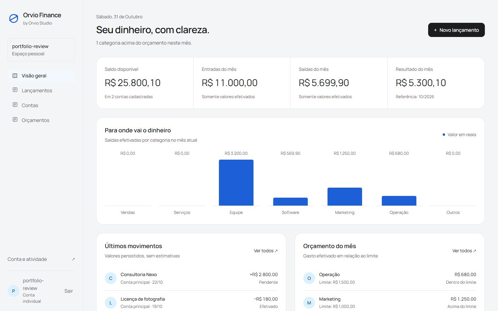

# Orvio Finance

[](https://github.com/orviostudio21/orvio-finance/actions/workflows/ci.yml)

Clareza para o próximo movimento. Contas, entradas, saídas e orçamento com números que você pode conferir.

Uma aplicação completa da [Orvio Studio](https://github.com/orviostudio21), com backend Django, banco relacional, autenticação e interface responsiva em português.



## Executar localmente

Requisitos: Python 3.12+ e Git. PostgreSQL é opcional para desenvolvimento.

```bash
git clone https://github.com/orviostudio21/orvio-finance.git
cd orvio-finance
python -m venv .venv
# Windows: .venv\Scripts\activate
# macOS/Linux: source .venv/bin/activate
pip install -r requirements.txt
python manage.py migrate
python manage.py runserver
```

Abra [localhost:8000](http://localhost:8000), crie uma conta e escolha **Adicionar dados de exemplo** ou cadastre seus próprios registros. Não há senha compartilhada nem serviço externo obrigatório. SQLite persiste os dados em `db.sqlite3`, ignorado pelo Git.

As variáveis são lidas do ambiente do processo. O arquivo `.env.example` é uma referência; no modo sem Docker, exporte as variáveis no terminal. O Django não carrega `.env` automaticamente.

## Docker + PostgreSQL

Crie `.env` com `DJANGO_SECRET_KEY` e `POSTGRES_PASSWORD` únicos e aleatórios. Gere cada um com `python -c "import secrets; print(secrets.token_urlsafe(48))"`. Nunca publique esse arquivo.

```bash
docker compose up --build
```

O Compose aplica migrações e inicia em localhost:8000 com volume PostgreSQL persistente. Para parar: `docker compose down` (sem `-v`, para preservar os dados). O Compose é uma configuração local; para produção siga [arquitetura e segurança](docs/architecture.md).

## Recursos comuns

- Cadastro, login, logout via POST e alteração de senha.
- Dados separados por usuário e relações protegidas contra acesso cruzado.
- CRUDs completos, busca, filtros, paginação e confirmação de exclusão.
- Dashboard derivado dos dados persistidos; histórico de atividade.
- Exportação CSV protegida contra fórmulas e API autenticada em `/api/overview/`.
- Dados fictícios opcionais, estáticos locais e health check em `/health/`.
- Migrações, Dockerfile, Compose PostgreSQL e GitHub Actions com SQLite/PostgreSQL.

## Verificar

```bash
python manage.py check
python manage.py makemigrations --check --dry-run
python manage.py test
python manage.py collectstatic --noinput
```

Leia [as funcionalidades e regras](docs/features.md), [a arquitetura](docs/architecture.md) e [a validação](docs/validation.md). Administradores podem ser criados com `python manage.py createsuperuser`.

## Licença

MIT. Fontes locais sob suas respectivas licenças SIL Open Font License, incluídas em `static/fonts/`.
